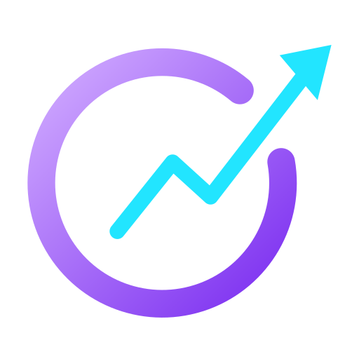

<p align="center"></p>

# Oviate

**O**ptimal **V**isions **I**nspire **A**ccurate **T**rade **E**ntries

Fast, keyboard-first desktop charting tool with a black and purple UI. Linux first, designed to port to Windows and macOS.

## Features

- **Charts:** 1, 2, 3 or 4 charts with draggable splits, 8 chart types (candles, hollow, bars, line, area, baseline, Heikin-Ashi, Renko), log scale, volume, crosshair/zoom/scroll sync between charts, 26 drawing tools (lines, rays, channels, pitchfork, shapes, Fibonacci retracement and extension, long/short position, price and date range, measure, brush, markers, text and callout with an inline editor).
- **Navigation:** scroll = move through time, `Shift`+scroll = stretch or squeeze the price axis, `Ctrl`+scroll = zoom both axes (stops when one axis reaches its limit), hold and drag = move the chart 1:1 with the cursor. Scrolling stops 10 candles after the newest one. `Ctrl` `+`/`-`/`0` zooms the whole app.
- **Data:** Alpaca (primary, live WebSocket for stocks and crypto) with Yahoo Finance as fallback. Candles and news are cached locally in SQLite, only missing ranges are fetched.
- **AI indicators and strategies (OpenRouter key in Settings, free models):** `/ind add ai` turns a plain-text description into a Pine indicator, `/strat add ai` into a complete strategy. The strategy form has the position size (required: % of account, cash amount or units), optional stop loss % and take profit %, and a direction. A strategy can draw each oscillator in its own pane (`plot(rsi, "RSI", pane="RSI")`, any number of panes). Both are checked by running them on sample data and repaired automatically, saved as normal `.pine` files and added to the chart. `/ind` and `/strat` open the code editor with nothing selected (search bar on the left). In the strategy editor a bar above the code always shows position size, stop loss % and take profit %, read from the code; changing them edits the code directly, no AI needed (stop loss / take profit only if the code has such an input). The AI button next to Check changes the open script with AI (plus a direction setting); the result lands in the editor for review (undo available), nothing is saved until you press Save.
- **Chart reset:** right-click the chart and choose Reset chart (or `/reset chart`, `Alt+R`) to fit the view like on a freshly opened timeframe.
- **Command bar:** `Enter` (or typing a letter) opens it. Plain text searches tickers and companies, `/` runs commands (timeframe, chart type, layout, indicators, strategies, news, paper trading, settings).
- **Indicators and strategies:** Pine Script (v5/v6 subset) files. 94 indicators ship in `indicators/`, strategies are user-written. Add your own with `/ind add new` and `/strat add new` (paste Pine code, saved as a `.pine` file).
- **Keybinds:** Settings > Keybinds (or `/keybinds` in the command bar) lists every shortcut (command bar, back / forward, app zoom, chart navigation, replay) with its default and every command-bar command with its command text; click a shortcut and press the new keys, edit a command text to rename it, any command can get a shortcut. A shortcut belongs to one action (assigning takes it from the old one); reset per row or all. Stored in the workspace.
- **Builder conversion cache:** Pine code the AI converted into the visual builder is stored by a hash of the code (`builder/cache.ts`): opening the builder on unchanged code is instant and costs no AI call. A background pass (15 s after start, 20 s after saving a strategy, then every 30 minutes; rate-limited conversions are retried every 3 minutes) converts strategies that have no builder model for their current code. The builder / code view you chose stays when you pick another strategy.
- **Back / forward:** Ctrl+Z or the mouse back button steps back through every view change one at a time (page, bottom panel tab and its sub views such as Journal trades / calendar, selected script and builder / code view, symbol and timeframe of each chart) drawing edits and changes in dropdowns, text fields, numbers and checkboxes (a field change is undone with Ctrl+Z while the field is not focused; a focused field keeps its own undo); clicking the open bottom tab folds the panel; Ctrl+Shift+Z (or Ctrl+Y) or the mouse forward button steps forward again (only after a step back). Text fields keep their own undo.
- **Paper trading a strategy:** hover the strategy label on the chart and press the wallet button: pick the paper account (one at a time) or stop paper trading. The label shows LIVE while it trades; orders are placed after every closed bar.
- **Trading journal:** the bottom panel has a "Journal" tab next to the Optimizer (`/journal`, right next to Paper Trading). Pick a paper account; the closed trades are listed newest first, profitable rows green, losing rows red, with filters (period, symbol, long / short, wins / losses, source), summary figures (win rate, profit factor, expectancy, streaks, average hold time, fees) and a note per trade. The Calendar view shows the P&L per day (colour intensity by size, click a day to see its trades) with weekly totals, and a month list with monthly P&L and green / red day counts. Logic in `paper/journal.ts` (pure, tested).
- **Optimizer:** the bottom panel has an "Optimizer" tab next to the Strategy Tester. It tunes the numeric inputs of the chart strategy with a pattern search (a better step is repeated at double size, a worse one is not extended), scores win rate first, then profit, then drawdown on the whole loaded history with newer parts weighted up to 6.5x, and returns 10 ranked variants: the absolute best visible win rate, profit and lowest drawdown (with enough trades), plus 7 mixes (balanced, win-rate focus, profit focus, safety first, recent market, consistent, robust plateau). Apply puts a variant on the chart. Also `oviate optimize` in the CLI. The Strategy Tester fills market orders at the close of the signal bar by default (where a cross is confirmed); Settings can switch to next-bar open.
- **`oviate` CLI** (`cli/oviate`, installed to `~/.local/bin` by `scripts/install-local.sh`, plus the `/oviate` Claude skill from `skills/oviate/`): `oviate check|add|list|show` for indicators and strategies, `oviate backtest <strategy> --symbol AAPL --tf 1d` and `oviate optimize` on the candles Oviate has cached (`oviate data`). Same Pine engine and statistics as the app; run `oviate help`.
- **Visual strategy builder:** (conditions can also use time of day / weekday, the high / low / open / close / volume of a daily window such as the pre-market session, the highest / lowest of the last N bars, the open position (entry price, bars in trade, profit %), "bars ago" and a percent offset, "between", at-least / at-most, a daily entry limit and a time zone; the model also supports a pre-market high/low breakout and an opening-range breakout (the template and time zone selectors were removed from the UI; intraday data with pre-market bars is needed for those)). The Direction dropdown (long only / short only / long and short) switches sides; a side that does not exist yet is created as the exact opposite of the other one (AI, with an offline fallback). `/visual` (or the Builder button in the strategy editor, "Edit in builder" in a chart strategy's menu) builds a strategy without code: the Builder button swaps only the code area of the editor for the builder (the button then reads Editor and switches back); the settings row above (size, stop loss, take profit, direction) and the AI text field with its send button stay. Pine code that was not made by the builder is read into the builder by the AI (closest indicators of your list) when you press Builder. Every condition is `left <comparison> right`: each side is a price (close, open, high, low, ...) or any indicator of your indicator list (searchable, with its plot and all its inputs), the right side can also be a fixed value or None. Comparisons: crosses above / below, is above / below (right side set) and is rising / falling / turns up / turns down (right side None). "within N bars" lets a condition count if it held on any of the last N bars. Each indicator offers an "Ideas" list of ready-made conditions that fit it (RSI levels 30/70, MACD against its signal, price against a moving average, ...). Entry and exit groups are ALL / ANY, with long and short sides, stop loss and take profit. "Fill with AI" turns a text description into the conditions (the model answers with the builder model, checked against the real indicator list). The result is a normal `.pine` strategy (the model is stored in an `@oviate-builder` comment) that reads library indicators through `oviate.ind("name", "Plot", "Input=value;...")`; all indicator inputs and values become strategy inputs, so the Optimizer can tune them.
- **Calendar:** the Calendar button next to News (or `/calendar`) opens macro events and company events (time in your zone) in a list with a detail pane like the news page: range tabs (±7 days, ±14 days around today; the list always opens with the next upcoming event at the top, or the event you clicked on a chart marker: scroll up for past events, down for coming ones), type, impact and region filters, "my symbols only" (watchlists and chart symbols), search, a "next event" countdown, actual vs forecast colouring, and a Groq reading per event (what it is, why it matters, typical reaction above / below the forecast, expected volatility; needs the Groq key from the news settings). The list re-checks for new events every 5 minutes and on window focus. Macro: the Forex Factory weekly calendar without a key (USD, EUR, GBP, JPY, CAD, AUD, NZD, CHF, CNY); a free Financial Modeling Prep key in Settings adds more countries, a wider range and actual values if your plan includes the endpoint (a free plan often answers HTTP 402: then the key is ignored for a day and the Forex Factory data stays). Forex Factory rate-limits (HTTP 429): after a failure it is not asked again for an hour and the cached events stay visible; a manual refresh works at most every 5 minutes. The free feed has no actual values and many events (speeches, holidays) have no figures, so the value boxes only show what exists. Companies, keyless from Nasdaq, 30 days back to 21 days ahead: quarterly earnings (fiscal quarter, EPS estimate, last year's EPS, market cap), ex-dividend dates, stock splits and IPOs. Charts show the macro events of the regions that matter for their symbol (a US stock: USD; EUR/USD: EUR and USD; a Dutch ADR: EUR and USD; events marked "All" always) and the company events of their own symbol as small tags above the news markers; zoomed out only the most important ones remain where tags would overlap, zooming in shows the rest (hover for the text, click opens the event on the page).
- **Chart sync:** with sync on the charts mirror each other completely: crosshair, time window, price axis, reset, and the last-price line sits at the same height in every chart.
- **Replay mode:** (with crosshair sync on, every chart replays the same moment) the Replay button on a chart (or `/replay`) lets you pick a bar with the scissors line; candles to its right disappear and a control bar steps (Shift+Left / Shift+Right), plays (Space) and sets the speed. Indicators and the Strategy Tester only see the visible candles.
- **Editor:** the file name can be changed after saving (Save renames the file and updates charts using it); "Save & add to chart" saves and adds the script unless it is already on the chart; the settings row (strategies: size, stop loss, take profit, direction) and the AI text field with its send button are always visible. The settings change the code directly, without AI: size in `strategy()`, stop loss / take profit as inputs plus an exit (added when the code has none), long only / short only / both as `allowLong` / `allowShort` switches on the entries. The file name and the script title are the same name.
- **Orders:** bracket take profit / stop loss accept a price or a percent (`5%` = move from the entry price).
- **Drawing:** "Arrow path" draws a zigzag arrow: every click adds a vertex, Enter / Esc / double click finishes it.
- **Zoom:** Ctrl+scroll zooms time and price by the same factor around the cursor (the x / y ratio stays, zoom stops when either axis hits its limit); Ctrl+Shift+scroll does the same with the newest candles at the right stop (the Reset chart framing). Alt+scroll stretches / squeezes the time axis, Shift+scroll the price axis. Plain scroll moves through time and the price scale follows the visible candles. All of it is mirrored on synced charts.
- **Strategy tester:** the equity chart has a legend with the final values of the strategy equity, buy & hold and buy & hold invested time only (click a legend entry to show or hide a line; buy & hold lines are off by default, and your choice of lines and scale is remembered) and a scale switch: "Equity" keeps (the line is purple above the starting capital and red below it; a scope run draws the equity live while it tests, security by security) the equity readable (a runaway buy & hold is cut at the edge, with a hint), "All lines" shows every line completely. A strategy on a chart shows its last 20 trades as entry-to-exit boxes (older ones as arrows), its indicators live on the chart, and a detailed report in the panel under the charts: equity and drawdown curves, performance, trade, risk (Sharpe, Sortino, Calmar, ...) and long-vs-short statistics, trade list.
- **Test scope:** the Strategy Tester (above the equity chart) and the Optimizer have a bar with Data age (1 to 20 years), Securities (10 to 200) and Timeframe; all three default to "Chart" (what the chart has loaded). The securities come from a built-in list of the 200 most important US-listed securities (all listed 10+ years), ordered strong / mid / weak performer one after the other so any first N is a mixed sample. Missing candles are fetched from Alpaca / Yahoo and stored in the local cache. The tester shows a data line (period, bars, slippage, fees, fill mode), a per-security table and a summary (profitable on x of N, median return); the optimizer tests every setting on all securities and shows on how many a variant is profitable. The chart keeps showing the last 20 trades of its own strategy whatever the scope is. Intraday history is limited by Yahoo (1m 7 days, 5-30m 59 days, 1h 2 years) unless Alpaca keys are set.
- **Time zone and sessions:** Settings > Time zone (one city per zone, default the computer's zone) sets how the time axis and crosshair time of intraday charts are shown; candles stay stored in UTC. The "Session time cheat sheet" (Settings button or `/sessions`) lists forex sessions and stock exchange hours at the venue, in UTC and in your zone, with daylight saving for today and an open / closed marker.
- **Background data:** shortly after start Oviate downloads daily, weekly, monthly (20 years) and 1 hour / 4 hour (2 years) candles of the 200 test securities in the background (Alpaca if keys are set, else Yahoo) and keeps them in the local cache; later rounds (every 6 hours) only add the newest candles, so the Strategy Tester and Optimizer start without waiting. Shorter timeframes are cached when first used.
- **Paper trading:** multiple accounts (capital, leverage, commission), market/limit/stop orders with optional take-profit and stop-loss, positions, orders, history, statistics and equity curve in the panel under the charts. Strategies can trade a paper account.
- **News:** markers on the chart for news about the symbol, a `/news` page with all headlines (week by week, cached locally), AI summary per headline via Groq.
- **Watchlists, analysis panel, English and German UI, dark and light theme, custom candle colors.**

## Stack

Tauri 2, Rust core (data providers, SQLite cache, news, keyring, Pine file storage), Svelte 5 + TypeScript UI, custom Canvas2D chart renderer, Pine engine in TypeScript running in a Web Worker.

## Development

Requirements: Node 22.18+ (tests run TypeScript directly), Rust stable, Tauri Linux dependencies (webkit2gtk-4.1, libsoup3, gtk3, openssl).

```bash
npm install
npm run tauri dev
```

| Command | Purpose |
|---|---|
| `npm run tauri dev` | Run the app |
| `npm run check` | Svelte/TypeScript type check |
| `npm test` | Pine engine, indicator library, strategy, AI pipeline, CLI and paper engine tests (Node), then Rust tests |
| `npm run tauri build` | Release bundle |

## Desktop launcher (Linux)

`npm run tauri build -- --no-bundle` builds `src-tauri/target/release/oviate`. A `~/.local/share/applications/oviate.desktop` entry pointing at that binary puts Oviate in the app menu; rebuild after code changes.

## Configuration

All secrets are entered in the app's Settings and stored in the OS keyring. Never commit keys.

| Setting | Used for |
|---|---|
| Alpaca key id and secret | Candles, live stream, Alpaca News |
| Finnhub, NewsAPI keys | Additional news providers |
| Liquid MCP login | Market brief (OAuth in the browser, read-only scope) |
| Groq key | AI news summaries |

Without any key, Oviate uses Yahoo Finance for candles and Google News, Yahoo and RSS feeds for news.

User scripts live as `.pine` files in the app data folder (`indicators/` and `strategies/`); the folder path is shown in the script editor.

## License

MIT

- **AI routing:** Pine code (indicators, strategies, edits) uses OpenRouter; the light structured builder tasks (code to builder, text to builder, mirrored side) go to Groq first (fast, separate limits) and fall back to OpenRouter (`ai_complete_light`).
